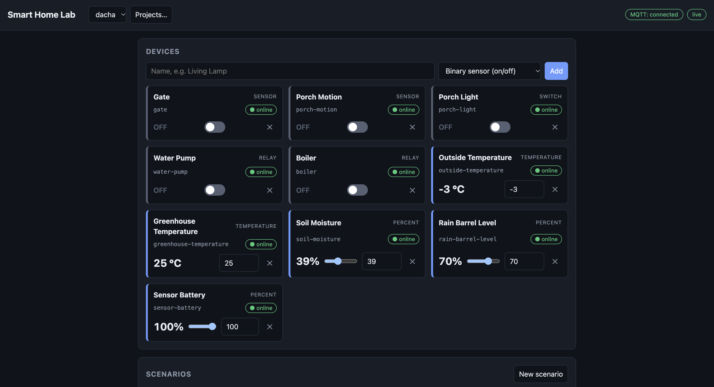
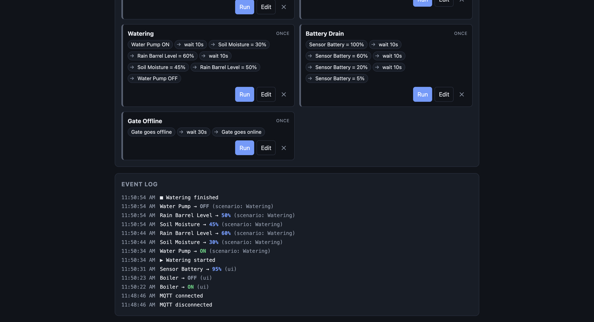

# Smart Home Lab

Virtual smart-home devices with a web UI, scripted scenarios and an MQTT bridge to
[Home Assistant](https://www.home-assistant.io/). Create sensors, switches and relays,
flip them by hand or with a scenario such as *lamp on → wait 10 s → lamp off*, and watch how your
automations react — before any real hardware is connected.



## Features

- **Devices** — five kinds:

  | Kind          | State                                  | In Home Assistant                    |
  |---------------|----------------------------------------|--------------------------------------|
  | `sensor`      | on/off                                 | `binary_sensor`                      |
  | `switch`      | on/off                                 | `switch`                             |
  | `relay`       | on/off                                 | `switch` (device class `outlet`)     |
  | `percent`     | whole number, **0–100**                | `sensor`, unit `%`                   |
  | `temperature` | whole number, **any, may be negative** | `sensor`, device class `temperature`, unit `°C` |

  Numbers are 32-bit integers. Only switches and relays accept commands from Home Assistant;
  sensors are changed from the UI, the API or a scenario.
- **Availability per device** — every device can be taken offline and brought back, by hand
  (the *online/offline* badge on its card), through the API, or with a scenario step. This is how
  you test automations that depend on a device disappearing. See [Availability](#availability).
- **Scenarios** — a list of `set device = value`, `device goes online/offline` and `wait N seconds`
  steps (the value is on/off or a number, depending on the device), optionally repeating until stopped. Build them in the UI, run
  and stop them at any time.
- **Live UI** — one page served by the binary itself; changes are pushed over Server-Sent Events,
  so several tabs always agree. An event log shows who changed what (UI, scenario or MQTT); a change made through the HTTP API, with
  `curl` too, is logged as `ui`, because the UI uses the same API.
- **Home Assistant** — MQTT Discovery: every virtual device appears as its own HA device with one
  entity. Commands from HA work for switches and relays. Availability is tracked with a last-will
  message, and everything is republished after a reconnect or when HA restarts.
- **Projects and presets** — keep several independent sets of devices and scenarios (a flat, a
  summer house, a test bench) and switch between them in the UI. New projects can start from a
  built-in preset (*Apartment*, *Dacha*) and projects can be exported and imported as files. See
  [Projects and presets](#projects-and-presets).
- **Persistence** — every project is saved on each change and survives restarts (`projects/<name>.json`).
- Single binary, no database, no build step for the frontend.

Scenarios are chains of steps, and the event log shows who changed what; here the *Watering* scenario
of the Dacha preset has just run:



## Quick start

```sh
cargo run          # needs Rust 1.88 or newer
```

Open <http://127.0.0.1:8765>, add a device, and try *New scenario* — it comes pre-filled with
`on → wait 10 s → off` for your first device. Or start with a ready-made set: **Projects… → New
project → Apartment** (or *Dacha*) gives you ten devices and a few scenarios to play with.

Everything the page does is also available over HTTP, for scripts and `curl`: see [API.md](API.md).

## Configuration

`config.toml` (all keys optional, shown with their defaults). It is read from the **working
directory**, so start the binary from the project folder. Settings are layered, later wins:
`config.toml` → `config.local.toml` (optional, git-ignored — put secrets here) → environment
variables such as `SHL_MQTT__ENABLED=true` or `SHL_SERVER__BIND=0.0.0.0:8765`. An unknown key or a
misspelled variable is an error, not silently ignored. Log verbosity: `RUST_LOG=debug`.

| Section    | Key                | Default          | Meaning                                         |
|------------|--------------------|------------------|-------------------------------------------------|
| `server`   | `bind`             | `127.0.0.1:8765` | HTTP address                                    |
| `storage`  | `dir`              | `projects`       | folder with one `<project>.json` per project    |
| `storage`  | `project`          | last used        | open this project instead of the last used one  |
| `mqtt`     | `enabled`          | `false`          | turn the bridge on                              |
| `mqtt`     | `host`, `port`     | `127.0.0.1`, `1883` | broker                                       |
| `mqtt`     | `username`, `password` | —            | broker login                                    |
| `mqtt`     | `client_id`        | generated per start | MQTT client id; two instances must not share one |
| `mqtt`     | `discovery_prefix` | `homeassistant`  | must match HA's discovery prefix                |
| `mqtt`     | `base_topic`       | `smarthomelab`   | prefix for state/command/status topics          |
| `mqtt`     | `remove_on_exit`   | `true`           | take the entities out of HA when the lab stops  |

## Projects and presets

A project is a file in `projects/` holding devices (with their states) and scenarios; the UI shows
the active one in the header. **Projects…** opens a dialog to create, duplicate, export, delete and
activate projects. A new project can start empty, as a copy of the current one, or from a preset:

| Preset      | What it is                                                                        |
|-------------|-----------------------------------------------------------------------------------|
| `apartment` | 10 devices (lamps, relays, motion/door/window sensors, a thermometer, humidity) and 4 scenarios |
| `dacha`     | 10 devices (gate, pump, boiler, two thermometers, soil moisture, rain barrel, battery) and 5 scenarios |

What switching does:

- Scenarios that are running are stopped first (the UI asks before it does that), and the project
  you leave is written to disk completely.
- The target file is read and checked **before** anything changes; a broken file leaves you where you were.
- With MQTT on, the entities of the old project are **removed** from Home Assistant and those of the
  new project are announced. Automations that refer to removed entities are left without them until
  you switch back.
  If both projects have a device with the same id but of a different kind, the old entity is
  removed first, so Home Assistant never sees two entities with one `unique_id`. (A kind changed by
  editing a file while the lab is stopped is not noticed; delete the stale entity's retained
  discovery message from the broker.)
- The event log starts afresh for the new project.

Notes: the project name becomes its file name (letters, digits, `-`, `_`; `My Flat` → `my-flat`;
at most 32 characters, longer names are cut). The active project cannot be deleted, and there is no
rename — duplicate it and delete the original. A project file is plain JSON (`devices` and
`scenarios`), the same format the Projects dialog exports and imports; it is written atomically
(temporary file, fsync, rename).

Which project opens at start: the one named by `SHL_STORAGE__PROJECT=dacha` (or
`[storage] project = "dacha"`), which must exist and be valid or the start fails with the reason;
otherwise the one used last time (recorded in `projects/.active`), then `default`, then the first
valid one in alphabetical order. A file that cannot be used is skipped with a warning in the log and
shown as *unusable* in the Projects dialog, where you can delete it; it is never overwritten. If no
project can be used, an empty `default` is created (unless a broken `default.json` is in the way —
then the start stops and tells you which file to fix or delete, or which project to open instead).

## Home Assistant

1. Have an MQTT broker and the MQTT integration in Home Assistant. With the official
   *Mosquitto broker* add-on: install it, create a user for the lab (Settings → People → Users),
   then accept the discovered MQTT integration. The add-on does not allow anonymous clients, so
   the lab needs that username and password.
2. Point the lab at the broker and restart it:

   ```toml
   # config.toml
   [mqtt]
   enabled = true
   host = "homeassistant.local"   # the machine running the broker
   username = "lab"
   ```

   Keep the password out of the tracked file: put `password = "…"` under `[mqtt]` in
   `config.local.toml` (git-ignored), or set `SHL_MQTT__PASSWORD`.

3. The devices appear under Settings → Devices & services → MQTT. The *MQTT: connected* badge in
   the UI header shows the bridge state.

Topics (with the default prefixes):

| Topic                                       | Direction | Payload                        |
|---------------------------------------------|-----------|--------------------------------|
| `homeassistant/<component>/<id>/config`     | lab → HA  | discovery JSON, retained       |
| `smarthomelab/<id>/state`                   | lab → HA  | `ON` / `OFF`, or the number (`-12`), retained |
| `smarthomelab/<id>/availability`            | lab → HA  | `online` / `offline`, retained |
| `smarthomelab/status`                       | lab → HA  | `online` / `offline`, retained (last will) |
| `smarthomelab/<id>/set`                     | HA → lab  | `ON` / `OFF` (switches, relays)|
| `homeassistant/status`                      | HA → lab  | `online` triggers a republish  |

### Cleaning up

Test runs must not pile entities up in Home Assistant. Removing an entity means clearing its retained
discovery, state and availability messages; the lab does that in these situations:

- **A device is deleted or the project is switched** while the lab runs: the old entities go at once.
  A device deleted while the connection to the broker was down is withdrawn when it reconnects.
- **The lab stops** (Ctrl-C, SIGTERM): with `remove_on_exit = true`, the default, every entity it
  announced is removed. Set it to `false` to keep them between runs (they show as `unavailable`
  while the lab is off, because the bridge's last will marks it offline).
- **The lab starts or reconnects**: it asks the broker for the discovery configs it holds and removes
  those of its own that the current project does not explain, such as the devices of an earlier run
  that was killed (`kill -9`, a crash) or that used another project. Only configs that carry the
  lab's `unique_id` (`shl_<id>`) and a state topic under the lab's own `base_topic` count as its own:
  other integrations' entities, and those of another lab on the same broker, are never touched.
  Start the lab on an empty project to sweep everything it ever left behind.

Once the lab has cleared a config, Home Assistant removes the device and its entity completely;
there is nothing left to delete by hand.

### Availability

Each entity is available in Home Assistant only while **both** the bridge (`smarthomelab/status`,
which also carries the last will) and the device (`smarthomelab/<id>/availability`) are online
(`availability_mode: all`). An offline device behaves like a real one that lost its connection:

- Its entity becomes `unavailable` in HA.
- It reports nothing while offline. Its state can still change in the lab (the "physical" device keeps
  working), and the current value is published as soon as it comes back, *before* it says `online`.
- Commands from HA are ignored.

### Trying the bridge without Home Assistant

```sh
docker compose up -d            # anonymous Mosquitto on :1883, for development only
SHL_MQTT__ENABLED=true cargo run
docker compose exec mosquitto mosquitto_sub -v -t '#'
docker compose exec mosquitto mosquitto_pub -t smarthomelab/<id>/set -m ON
```

## How it works

```
 UI (browser) ──REST──────┐                          ┌─► SSE /api/events ──► UI
 scenario runner ─────────┼─► Lab::set_state ────────┼─► MQTT bridge ──────► Home Assistant
 HA ──MQTT /set──► bridge ┘   (devices, scenarios,   ├─► event log (last 200)
                               broadcast event bus)  └─► persister ────────► projects/<name>.json
```

`Lab` is the single write path: the UI, the scenario runner and MQTT commands all call
`Lab::set_state`, which updates the state and publishes an event only when the value really
changed. Everything else — SSE, the MQTT bridge and the log — is a subscriber of that event stream, so
adding another consumer never touches the producers. The file persister listens to a separate `watch`
channel that always holds the latest state *together with the name of the project it belongs to*:
bursts of changes collapse into one write, and a write can never land in another project's file.

A project file is checked with the same rules as an API request when it is loaded; a file that breaks
them (for example a repeating scenario without a delay) stops the start with a message that names
the offending item. On Ctrl-C and SIGTERM the open event streams are closed, requests in flight get up
to five seconds to finish, the bridge marks itself offline and the last state is written before the
process exits.

- `src/domain` — validated types: `DeviceId`, `Device`, `Scenario`, `Step`.
- `src/lab.rs` — state, event bus, log; `src/runner.rs` — scenarios as cancellable tokio tasks.
- `src/projects` — the folder of project files (`store.rs`), switching, creating and deleting
  (`service.rs`), the built-in presets (`presets.rs`); `src/storage.rs` — atomic file writes and the persister.
- `src/mqtt` — topic names and discovery payloads are pure functions; `bridge.rs` runs a poller task
  (connection and incoming messages) and a publisher task (lab events → broker).
- `src/app.rs` — the lab, the runner and the project service wired together once (`main` builds it);
  `src/web` — axum routes and the request guards; `static/` — the UI, embedded into the binary.

## Tests

```sh
cargo test                       # unit + HTTP API tests, no broker needed
docker compose up -d --wait      # a local Mosquitto, bound to 127.0.0.1
cargo test -- --ignored          # MQTT bridge tests against a real broker
cargo test -- --include-ignored  # everything, as CI does
```

The scenario unit tests run on tokio's paused clock, so "wait 10 s" takes no real time (the HTTP
scenario tests use real one-second delays). The MQTT tests use a second client that plays Home
Assistant (reads discovery, sends commands and the birth message) and private topic prefixes, so
they never touch a real Home Assistant installation. A small TCP relay between the bridge and the
broker lets them cut the connection to test the last will, the reconnect and the cleanup after an
outage. Without a broker they stop with a hint instead of a timeout.

## Known trade-offs

Decisions that keep the code small and that you would revisit if the project grew:

- **One active project, global to the server.** The lab, the MQTT bridge (one Home Assistant "home")
  and every request refer to it, so the same URL means different things after a switch. The
  `X-Project` header protects a stale page; running several projects at once would need several labs.
- **The domain types are also the API bodies, the SSE messages and the file format.** One model is
  less code, but changing a type changes all three contracts, and `Device`/`Scenario` can be built
  in an invalid state by deserialization (`validate()` re-checks what came from a file). Project
  files have no version field; a file with keys this version does not know is read without them.
- **`Lab` has many jobs** (devices, scenarios, the event bus and log, the feed for the persister, and
  the MQTT connection state, which is infrastructure that the UI shows), and `EventKind` is both an
  internal bus and the public SSE contract.
- **The UI script has no automated tests.** The API is covered by the HTTP tests; the page was
  checked by hand in a browser.
- **The origin check compares `Origin` with `Host`.** Behind a reverse proxy that rewrites `Host` it
  refuses the UI's own requests; the lab is meant for `127.0.0.1` or a trusted network.
- **Settings are read from the working directory** (`config.toml`), so start the binary from the
  project folder.

## Scope

Not included (yet): renaming a project, decimal values (temperature is a whole number of degrees), random simulation
generators, event-triggered scenarios, linking devices to each other, authentication in the UI, TLS for MQTT.
The UI has no authentication — keep it on `127.0.0.1` or a trusted network.

## TODO

Ideas for what comes next, roughly in the order they would be done:

- [ ] **Expected values in scenarios.** A step that checks a device's state and fails the run when it does
  not match, so a scenario becomes a test: *set the door sensor on → wait 10 s → expect the lamp on*
  (the lamp being switched by a Home Assistant automation over MQTT). A failed check would show up as a
  failed run in the UI and in the event log. A variant would wait up to N seconds for the value instead
  of checking after a fixed pause.
- [ ] **A redesigned UI.** The current page is a plain, dependency-free one; it needs a clearer layout for
  many devices, a better scenario editor and automated tests for the script.
- [ ] **More protocols next to MQTT.** The bridge to Home Assistant is the only transport today. Candidates:
  the **ESPHome native API**, so that lab devices show up in Home Assistant as ESPHome devices, and
  **zigbee2mqtt**, publishing devices in its topic layout. Both mean putting the MQTT bridge behind a
  transport abstraction first.

## License

[MIT](LICENSE)
